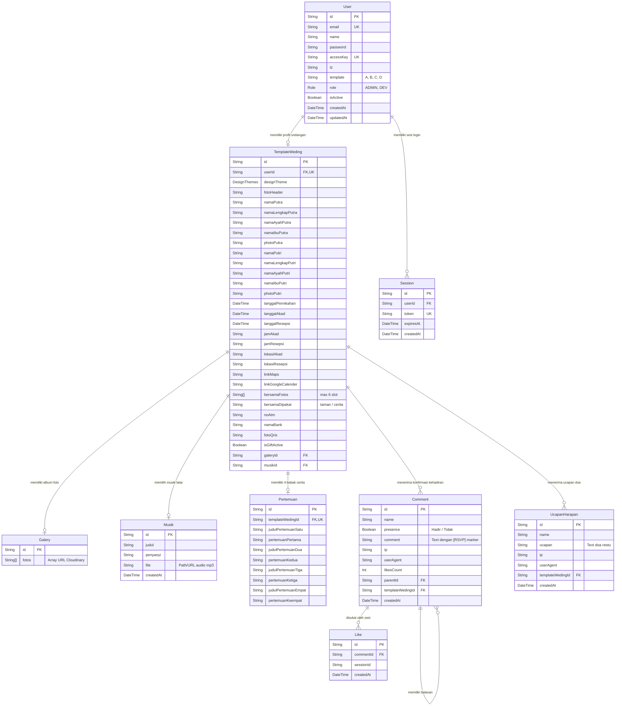

# 📡 API & DATA — DOKUMENTASI ENDPOINT, SKEMA, & RELASI DATABASE

Dokumen ini mendokumentasikan spesifikasi seluruh endpoint REST API serta struktur skema database PostgreSQL yang dikelola melalui Prisma ORM.

---

## 1. Entity-Relationship Diagram (ERD Database)



---

## 2. Katalog Endpoint API Backend

### 🔐 Autentikasi & Akun

#### `POST /api/auth/[...nextauth]`
- **Deskripsi**: Menangani login kredensial NextAuth.
- **Body**: `{ email: string, password: string }`
- **Output (200 OK)**: Cookie sesi JWT diatur pada browser.
- **Status Gagal**: `401 Unauthorized` jika kredensial salah.

#### `POST /api/auth/register`
- **Deskripsi**: Registrasi akun pengantin baru.
- **Body**: `{ email, name, password }`
- **Output (201 Created)**: Data user baru dibuat beserta inisialisasi awal profil `TemplateWeding`.

---

### 💌 Konfirmasi Kehadiran Tamu (RSVP)

#### `GET /api/comments`
- **Deskripsi**: Mengambil daftar entri konfirmasi kehadiran (RSVP) atau komentar.
- **Query Params**:
  - `templateWedingId` (wajib, string)
  - `kind` (opsional): `'rsvp'` (hanya komentar berawalan `[RSVP]`), `'wish'` (hanya komentar non-RSVP).
  - `limit` (opsional, integer, default 0/semua, max 100).
  - `offset` (opsional, integer).
- **Cookie**: Membaca / menetapkan `session_id` untuk status `liked: boolean`.
- **Output (200 OK)**:
  ```json
  {
    "success": true,
    "comments": [
      {
        "id": "uuid",
        "name": "Budi Santoso",
        "presence": true,
        "comment": "[RSVP] Hadir · 2 Orang — Selamat ya!",
        "likesCount": 1,
        "liked": false,
        "createdAt": "2026-10-15T03:00:00.000Z"
      }
    ],
    "total": 1,
    "hasMore": false
  }
  ```

#### `POST /api/comments`
- **Deskripsi**: Mengirimkan konfirmasi kehadiran baru oleh tamu.
- **Body**:
  ```json
  {
    "name": "Budi Santoso",
    "presence": true,
    "comment": "[RSVP] Hadir · 2 Orang — Semoga samawa",
    "templateWedingId": "cuid",
    "kind": "rsvp"
  }
  ```
- **Output (201 Created)**: Objek komentar baru berhasil dibuat.

#### `POST /api/comments/[id]/like`
- **Deskripsi**: Toggle suka (*like / unlike*) pada sebuah komentar/RSVP.
- **Identifikasi**: Membaca cookie HTTP-Only `session_id`.
- **Output (200 OK)**: `{ "liked": true }` atau `{ "liked": false }`.

#### `DELETE /api/comments/[id]/delete`
- **Deskripsi**: Menghapus baris komentar/RSVP.
- **Proteksi**: Wajib login (Admin pemilik undangan).
- **Output (200 OK)**: `{ "success": true, "message": "Comment deleted" }`.

---

### 🌸 Doa Restu & Harapan (Tabel Khusus `ucapan_harapan`)

#### `GET /api/ucapan`
- **Deskripsi**: Mengambil feed ucapan doa restu tamu (Pohon Harapan / Kebun Doa).
- **Query Params**: `templateWedingId` (wajib), `limit` (integer), `offset` (integer).
- **Output (200 OK)**:
  ```json
  {
    "success": true,
    "ucapan": [
      {
        "id": "cuid",
        "name": "Ahmad Fauzi",
        "ucapan": "Barakallahu lakum wa baraka alaikum",
        "createdAt": "2026-10-15T02:30:00.000Z"
      }
    ],
    "total": 12,
    "hasMore": false
  }
  ```

#### `POST /api/ucapan`
- **Deskripsi**: Mengirim doa restu tamu ke tabel `ucapan_harapan`.
- **Body**: `{ "name": "Siti Aminah", "ucapan": "Selamat berbahagia", "templateWedingId": "cuid" }`
- **Output (201 Created)**: Data ucapan baru.

#### `DELETE /api/ucapan/[id]/delete`
- **Deskripsi**: Menghapus ucapan doa oleh admin pemilik undangan.

---

### 🎨 Pengaturan Undangan & Media (Landing & Galeri)

#### `GET /api/landing/[id]`
- **Deskripsi**: Mengambil seluruh detail profil pernikahan berdasarkan `userId`.
- **Output (200 OK)**: Objek lengkap `TemplateWeding` beserta relasi `galery`, `pertemuan`, `comments`, dan `musik`.

#### `PUT /api/landing/[id]`
- **Deskripsi**: Memperbarui informasi mempelai, jadwal acara, dan upload foto via `multipart/form-data`.
- **Field**: `namaPutra`, `namaPutri`, `tanggalAkad`, `jamAkad`, `noAtm`, `namaBank`, file upload (`photoPutra`, `photoPutri`, `fotoHeader`, dsb.).
- **Upload**: Otomatis dikirim ke Cloudinary, dan URL secure disimpan ke database.

#### `PUT /api/landing/[id]/bersama`
- **Deskripsi**: Memperbarui array 6 foto kebersamaan (*love story*) tanpa menimpa field profil lainnya.
- **Body**: `{ "bersamaFotos": ["url1", "url2"], "bersamaDipakai": "taman" | "cerita" }`
- **Output (200 OK)**: `{ "success": true, "data": ... }`

#### `PUT /api/landing/[id]/musik`
- **Deskripsi**: Menetapkan musik latar pengiring undangan.
- **Body**: `{ "musikId": "uuid-musik" }`
- **Fallback**: Memiliki safe execution fallback menggunakan Raw SQL jika Prisma runtime cache terkunci.

#### `GET /api/musik`
- **Deskripsi**: Mengambil katalog musik pengiring yang tersedia di sistem dari tabel `musik`.

#### `GET /api/galery/[id]` & `PUT /api/galery/[id]`
- **Deskripsi**: Mengambil atau mengganti seluruh kumpulan foto album photoshoot pada tabel `galeries.fotos`.
- **Body (PUT)**: `{ "fotos": ["url1", "url2", "url3", ...] }`

#### `POST /api/upload/image`
- **Deskripsi**: Endpoint mandiri pengunggahan file gambar ke Cloudinary folder `udangan/gallery`.
- **Output (200 OK)**: `{ "success": true, "url": "https://res.cloudinary.com/..." }`

#### `PUT /api/user/template`
- **Deskripsi**: Mengubah template aktif pengguna.
- **Body**: `{ "template": "A" | "B" | "C" | "D" }`
- **Output (200 OK)**: `{ "success": true, "message": "Template berhasil diperbarui" }`

#### `GET /api/stats`
- **Deskripsi**: Menghitung ringkasan kehadiran (`comments`, `likes`, `present`, `absent`) per `templateWedingId`.
