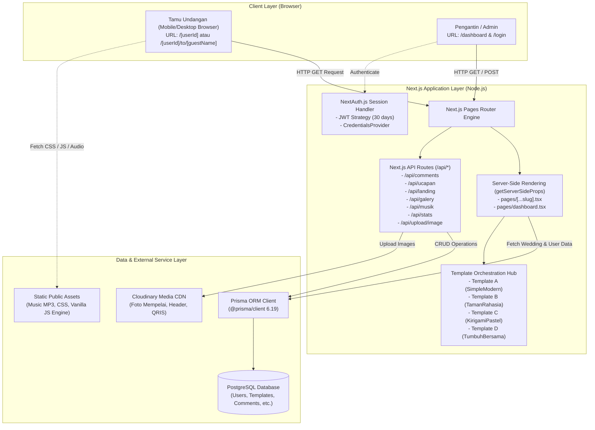
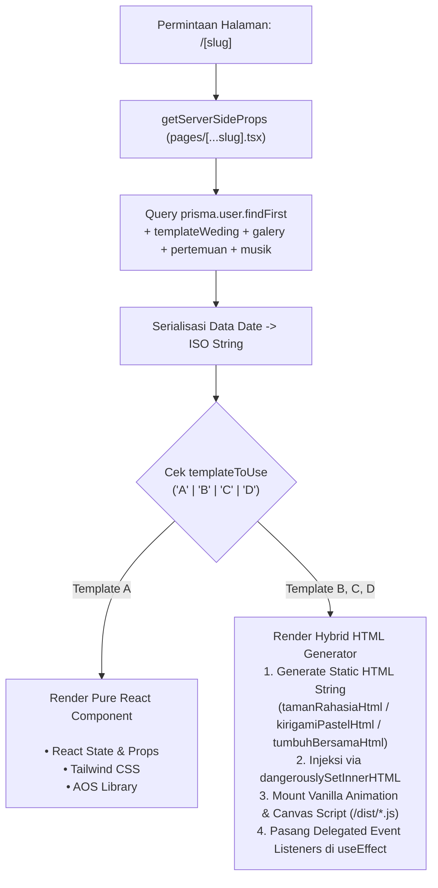
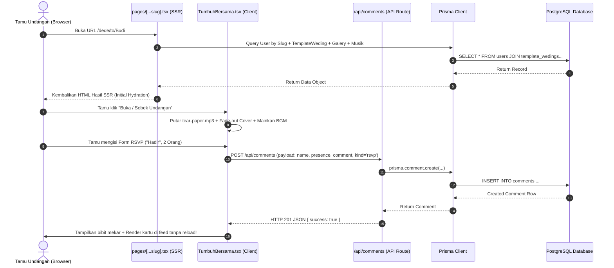

# 🏗️ ARCHITECTURE — ARSITEKTUR SISTEM & DESAIN TEKNIS

## 1. Diagram Arsitektur Tingkat Tinggi (High-Level Architecture)

Aplikasi dibangun menggunakan model arsitektur **Next.js Pages Router Monolith**, di mana server menangani Server-Side Rendering (SSR) untuk SEO dan halaman publik, melayani REST API internal, serta mengelola autentikasi berbasis sesi JWT.



---

## 2. Paradigma Rendering: Dual-Layer Render (Hybrid SSR + Vanilla Canvas/DOM Engine)

Projek ini menerapkan dua pola render yang berbeda tergantung jenis template yang dipilih oleh pengguna:



### Mengapa Pendekatan Hybrid Digunakan untuk Template B, C, dan D?
Template B, C, dan D berasal dari desain interaktif berbobot visual tinggi (efek kanvas pohon yang tumbuh dinamis, animasi potong kertas kirigami, sobek kertas amplop, dan audio synth). Agar performa tetap optimal dan tidak terganggu siklus re-render React berulang-ulang:
1. **Markup HTML di-render sekali** saat halaman dimuat.
2. **Skrip Vanilla Engine (`/dist/*.js`)** mengontrol rendering kanvas 60 FPS di luar virtual DOM React.
3. **Komponen React wrapper (`TamanRahasia.tsx`, `KirigamiPastel.tsx`, `TumbuhBersama.tsx`)** bertindak sebagai *bridge*: menangani sinkronisasi data API, event klik, salin rekening, audio BGM, dan validasi formulir tanpa memicu re-render virtual DOM yang dapat merusak status kanvas.

---

## 3. Arsitektur Tampilan Tamu (Guest View) vs Admin Dashboard

```
┌─────────────────────────────────────────────────────────────────────────────┐
│                            PEMISAHAN HAK AKSES                              │
├──────────────────────────────────────┬──────────────────────────────────────┤
│ 👤 GUEST VIEW (pages/[...slug].tsx)  │ 🛡️ ADMIN DASHBOARD (pages/dashboard) │
├──────────────────────────────────────┼──────────────────────────────────────┤
│ • URL: /[userId] atau /[userId]/to/.. │ • URL: /dashboard                    │
│ • Hak Akses: Publik (Tamu Undangan)  │ • Hak Akses: Terproteksi (NextAuth)  │
│ • Sifat: MURNI READ-ONLY             │ • Sifat: FULL CRUD READ-WRITE        │
│ • Tidak ada tombol edit / admin panel│ • Memuat 10 tab pengaturan lengkap   │
│ • Form hanya untuk RSVP & Doa Restu  │ • Upload media langsung ke Cloudinary│
│ • State cover di-lock di awal        │ • Mengubah pilihan template aktif    │
└──────────────────────────────────────┴──────────────────────────────────────┘
```

---

## 4. Arsitektur Aliran Data (Data Flow Architecture)



---

## 5. Pola Zero Page Reload & Event Delegation

Untuk memastikan interaksi tamu terasa mulus di perangkat mobile:
1. **Form Attribute**: Semua formulir di Template B, C, dan D diberi atribut `onsubmit="return false;"`.
2. **Tombol Submit**: Menggunakan `<button type="button">` (bukan `type="submit"` default HTML form yang me-refresh halaman).
3. **Delegated Event Listener**: Komponen React wrapper memasang listener level dokumen menggunakan fase capture (`useCapture = true`) pada ID form (`#rs-form`, `#ws-form`, `#gf-copy-btn`). Hal ini menjamin event selalu tertangkap meskipun elemen DOM dirender ulang.
4. **Optimistic & Live DOM Update**: Setelah respons `200/201 OK` dari backend diterima, fungsi JavaScript langsung menyisipkan elemen card baru ke container feed (`#ws-bed`, `#rsvp-comments-list`) dan mengupdate angka statistik secara langsung.
