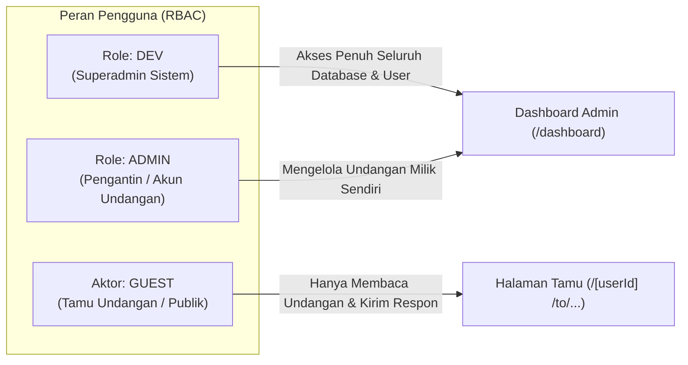

# 🧠 BUSINESS LOGIC — ATURAN BISNIS, VALIDASI, ROLE, & SIKLUS HIDUP

Dokumen ini mendokumentasikan seluruh logika bisnis, validasi, pemisahan entitas, aturan hak akses, dan siklus hidup (*lifecycle*) data yang berlaku pada sistem.

---

## 1. Role Pengguna & Batasan Hak Akses (RBAC)

Aplikasi memiliki dua tingkatan aktor dalam sistem:



### Matriks Izin Akses (Permissions Matrix)

| Aksi / Kemampuan | DEV | ADMIN | GUEST (Tamu) |
| :--- | :---: | :---: | :---: |
| Mengubah data profil mempelai | ✅ | ✅ (Milik sendiri) | ❌ |
| Mengubah jadwal akad & resepsi | ✅ | ✅ (Milik sendiri) | ❌ |
| Upload foto header & profil ke Cloudinary | ✅ | ✅ (Milik sendiri) | ❌ |
| Mengunggah/menghapus album galeri | ✅ | ✅ (Milik sendiri) | ❌ |
| Memilih template aktif (`A`, `B`, `C`, `D`) | ✅ | ✅ (Milik sendiri) | ❌ |
| Memilih musik latar dari katalog | ✅ | ✅ (Milik sendiri) | ❌ |
| Menghapus komentar / RSVP | ✅ | ✅ (Milik sendiri) | ❌ |
| Menghapus ucapan doa harapan | ✅ | ✅ (Milik sendiri) | ❌ |
| Membaca halaman undangan | ✅ | ✅ | ✅ (Murni Read-Only) |
| Mengisi form kehadiran (RSVP) | ❌ | ❌ | ✅ |
| Mengirimkan ucapan doa restu | ❌ | ❌ | ✅ |
| Menyukai (*Like*) komentar tamu lain | ✅ | ✅ | ✅ (Via Cookie Session) |

> [!CAUTION]
> **ATURAN READ-ONLY TAMPILAN TAMU (`pages/[...slug].tsx`)**:
> Halaman publik tamu **MUTLAK READ-ONLY** terhadap data pengantin. Dilarang keras menampilkan tombol pensil, form edit profil, modal upload foto, atau link ke dashboard admin pada halaman tamu.

---

## 2. Aturan Emas Pemisahan 4 Fitur Utama Database (NON-NEGOTIABLE)

Untuk mencegah data tertukar atau terhapus secara tidak sengaja, sistem memisahkan 4 jenis data ke dalam entitas database yang berbeda:

```
┌─────────────────────────────────────────────────────────────────────────────────┐
│                    ATURAN PEMISAHAN 4 FITUR UTAMA DATABASE                      │
├────┬─────────────────────────────┬──────────────────────────┬───────────────────┤
│ NO │ FITUR / KEBUTUHAN           │ MODEL / TABEL DATABASE   │ PENJELASAN TEKNIS │
├────┼─────────────────────────────┼──────────────────────────┼───────────────────┤
│ 1  │ Album Foto Galeri           │ Model: Galery            │ Array URL foto    │
│    │ (Photoshoot / Prewedding)   │ Tabel: galeries          │ dinamis dalam     │
│    │                             │ Kolom: fotos (String[])  │ jumlah banyak.    │
├────┼─────────────────────────────┼──────────────────────────┼───────────────────┤
│ 2  │ Kisah Pertemuan             │ Model: TemplateWeding    │ Maksimal 6 foto   │
│    │ (Love Story / Kenangan)     │ Kolom: bersama_fotos     │ dokumentasi babak │
│    │                             │ Tabel relasi: pertemuan  │ perjalanan cinta. │
├────┼─────────────────────────────┼──────────────────────────┼───────────────────┤
│ 3  │ Konfirmasi Kehadiran Tamu   │ Model: Comment           │ Berisi marker     │
│    │ (RSVP Form)                 │ Tabel: comments          │ [RSVP], jumlah    │
│    │                             │ Kolom: presence (Boolean)│ pax, & status.    │
├────┼─────────────────────────────┼──────────────────────────┼───────────────────┤
│ 4  │ Ucapan & Doa Harapan        │ Model: UcapanHarapan     │ Tabel terpisah,   │
│    │ (Pohon Harapan / Kebun Doa) │ Tabel: ucapan_harapan    │ ringan, khusus    │
│    │                             │ Kolom: ucapan (Text)     │ doa restu tamu.   │
└────┴─────────────────────────────┴──────────────────────────┴───────────────────┘
```

---

## 3. Kamus Identifikasi Mempelai: Pria (Groom) vs Wanita (Bride)

Pengembang maupun AI wajib menggunakan kolom yang tepat saat membaca atau menulis data mempelai:

### 🤵 Mempelai Pria (Putra / Groom)
- Nama Panggilan: `namaPutra` (DB: `nama_putra`) — contoh: *"Wahyu"*, *"Badriana"*
- Nama Lengkap & Gelar: `namaLengkapPutra` (DB: `nama_lengkap_putra`)
- Nama Ayah: `namaAyahPutra` (DB: `nama_ayah_putra`)
- Nama Ibu: `namaIbuPutra` (DB: `nama_ibu_putra`)
- Urutan Lahir / Keterangan: `kelahiranPutra` (DB: `kelahiran_putra`)
- Instagram: `instagramPutra` (DB: `instagram_putra`)
- Foto Profil: `photoPutra` (DB: `photo_putra`)

### 👰 Mempelai Wanita (Putri / Bride)
- Nama Panggilan: `namaPutri` (DB: `nama_putri`) — contoh: *"Riski"*, *"Izzah"*
- Nama Lengkap & Gelar: `namaLengkapPutri` (DB: `nama_lengkap_putri`)
- Nama Ayah: `namaAyahPutri` (DB: `nama_ayah_putri`)
- Nama Ibu: `namaIbuPutri` (DB: `nama_ibu_putri`)
- Urutan Lahir / Keterangan: `kelahiranPutri` (DB: `kelahiran_putri`)
- Instagram: `instagramPutri` (DB: `instagram_putri`)
- Foto Profil: `photoPutri` (DB: `photo_putri`)

---

## 4. Siklus Hidup & Transisi Status (State Lifecycles)

### A. Siklus Buka Sampul Undangan (Invitation Cover Lifecycle)
1. **Initial State (`LOCKED`)**:
   - `body` diberikan class `.is-locked` (atau `.is-covered` pada Template D). Scroll viewport terkunci.
   - Tombol buka undangan ("Buka Undangan" atau "Sobek & Tanam") tampil di tengah layar.
   - Pengecekan `sessionStorage.getItem('invitation_opened_' + adminId)`: jika bernilai `'true'`, sampul langsung dilewati (*unlocked state*).
2. **Action: Tamu Menekan Tombol**:
   - Audio sobek kertas (`tear-paper.mp3`) diputar (Template D).
   - Class `.is-open` atau `.is-gone` ditambahkan ke elemen cover.
   - Kunci scroll dilepas: `document.body.classList.remove('is-locked')`.
   - Audio latar belakang (*background music*) mulai diputar secara otomatis (`audio.play()`).
   - Flag `sessionStorage.setItem('invitation_opened_' + adminId, 'true')` disimpan agar status bertahan jika tamu me-refresh browser.

### B. Siklus Konfirmasi Kehadiran (RSVP Lifecycle)
1. Tamu memilih opsi status kehadiran:
   - **Hadir** $\rightarrow$ `presence: true`, format marker: `[RSVP] Hadir · X Orang — [catatan]`.
   - **Berhalangan** $\rightarrow$ `presence: false`, format marker: `[RSVP] Berhalangan · 0 Orang — [catatan]`.
   - **Masih Ragu** $\rightarrow$ `presence: false`, format marker: `[RSVP] Masih Ragu · 0 Orang — [catatan]`.
2. Validasi input: nama maksimal 80 karakter, catatan maksimal 2000 karakter, sanitasi tag HTML.
3. Tombol submit mengirim request ke `/api/comments` dengan `kind: 'rsvp'`.
4. Jika sukses: form berganti status ke `.is-submitted` (animasi bibit mekar di Template D), data langsung ditambahkan ke feed RSVP, dan tombol ubah jawaban kehadiran disediakan.

### C. Siklus Ucapan Doa Restu (Pohon Harapan / Kebun Doa)
1. Form ucapan menerima nama tamu dan teks doa.
2. Form memanggil endpoint `/api/ucapan`.
3. Entri disimpan di tabel `ucapan_harapan` dan langsung di-render sebagai kartu daun/bunga tanpa perlu memuat ulang (*reload*) halaman.

### D. Siklus Amplop Digital & Hadiah (Love Gift)
- Kontrol visibilitas:
  - `isGiftActive`: Jika `false`, seluruh bagian amplop digital disembunyikan.
  - `isBankActive`: Mengontrol tampilan nomor rekening dan tombol "Salin Nomor Rekening".
  - `isQrisActive`: Mengontrol tampilan gambar kode QRIS digital.
- Tombol salin nomor rekening menggunakan `navigator.clipboard.writeText()` dengan fallback `document.execCommand('copy')`.
- Tombol konfirmasi WhatsApp membuka URL `https://wa.me/{nomorHp}?text=...` dengan format nomor internasional yang sudah disanitasi (`62...`).

---

## 5. Validasi & Sanitasi Data

1. **Anti-HTML Injection / XSS**:
   - Semua input nama dan teks ucapan disaring melalui fungsi `cleanText(value, maxLength)` dan di-escape menggunakan `escapeHtml()` saat disuntikkan ke DOM.
2. **Proteksi Awalan RSVP**:
   - Jika endpoint komentar biasa dipanggil tanpa `kind === 'rsvp'`, awalan `[RSVP]` otomatis dihapus oleh fungsi `stripRsvpPrefix()` untuk mencegah tamu memalsukan entri RSVP melalui form komentar umum.
3. **Identifikasi Sesi Like Unik Tanpa Login**:
   - Sistem menetapkan cookie HTTP-Only `session_id` berumur 365 hari untuk melacak apakah tamu telah menyukai (*like*) sebuah komentar atau ucapan, sehingga tamu tidak dapat melakukan spam like berulang kali.
