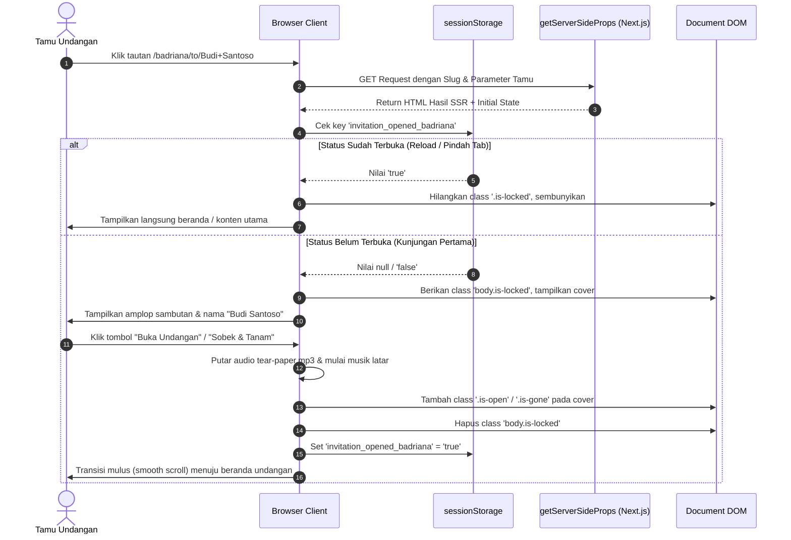
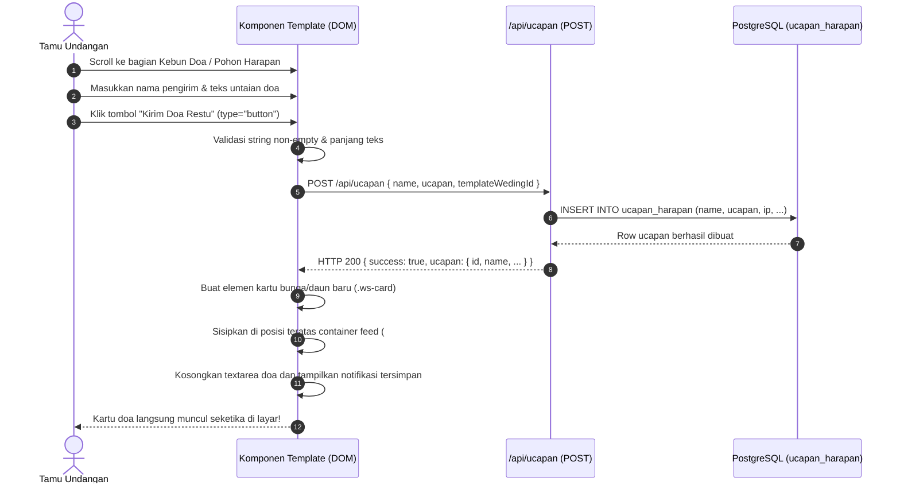
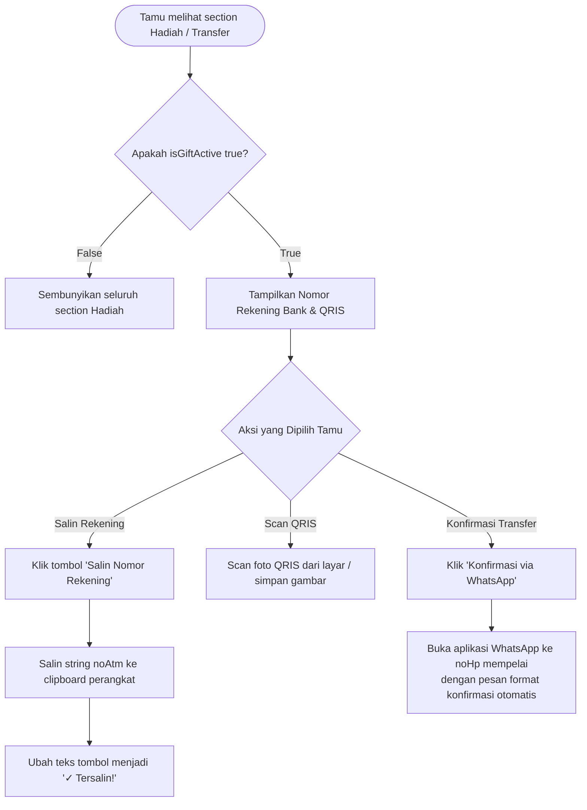
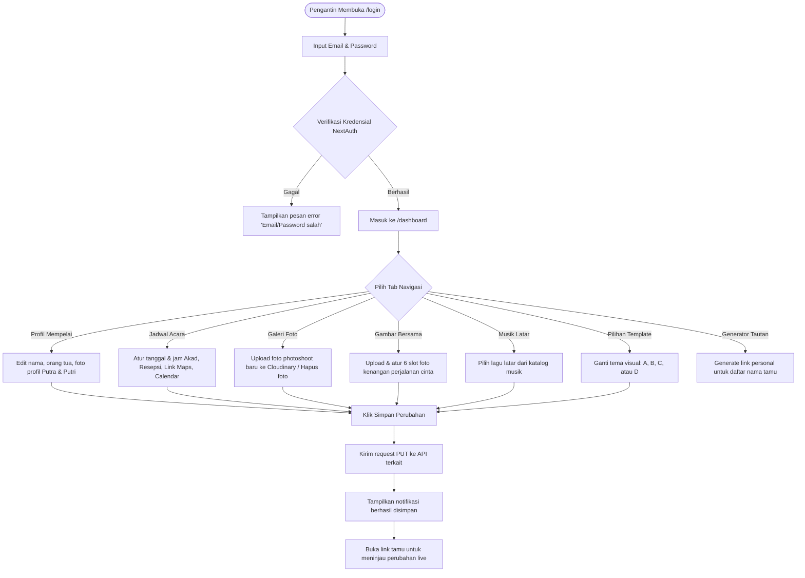

# 🚶 USER FLOWS — PEMETAAN ALUR PENGGUNA END-TO-END

Dokumen ini memetakan alur interaksi pengguna dari awal hingga akhir, mencakup antarmuka tamu (*Guest View*) dan antarmuka pengantin (*Admin Dashboard*).

---

## 1. Alur Tamu: Membuka Undangan & Melepas Sampul (Invitation Open Flow)



---

## 2. Alur Tamu: Konfirmasi Kehadiran Tamu (RSVP Flow)

```mermaid
flowchart TD
    START([Tamu Scroll ke Section RSVP]) --> INPUT_NAME[Input Nama Tamu\nAuto-fill dari URL jika ada]
    INPUT_NAME --> CHOOSE_STATUS{Pilih Kehadiran}
    
    CHOOSE_STATUS -->|Hadir| OPT_HADIR[Pilih Jumlah Tamu / Pax\n1 s.d. 5 Orang]
    CHOOSE_STATUS -->|Berhalangan| OPT_ABSENT[Set Pax = 0]
    CHOOSE_STATUS -->|Masih Ragu| OPT_MAYBE[Set Pax = 0]
    
    OPT_HADIR --> INPUT_NOTES[Tulis Pesan / Catatan Konfirmasi]
    OPT_ABSENT --> INPUT_NOTES
    OPT_MAYBE --> INPUT_NOTES
    
    INPUT_NOTES --> SUBMIT_BTN[Klik Tombol Kirim Kehadiran]
    SUBMIT_BTN --> JS_HANDLER[JavaScript menangkap event click\n(Mencegah default form refresh)]
    JS_HANDLER --> API_POST[POST /api/comments\nPayload: name, presence, comment: '[RSVP] ...', kind: 'rsvp']
    
    API_POST --> DB_SAVE[(Simpan di Tabel comments)]
    DB_SAVE --> API_RESP[Kembalikan Status 201 Created]
    
    API_RESP --> ANIMATION[Picukan Animasi Mekar / Sukses\n(Sound seed & bloom di Template D)]
    ANIMATION --> INJECT_DOM[Sisipkan Kartu RSVP ke Feed Tamu\nPerbarui Widget Statistik Kehadiran]
    INJECT_DOM --> SHOW_EDIT_BTN[Tampilkan Tombol 'Ubah Jawaban'\nJika Tamu Ingin Mengoreksi]
    SHOW_EDIT_BTN --> END([Selesai])
```

---

## 3. Alur Tamu: Mengirimkan Ucapan & Doa Restu (Pohon Harapan / Kebun Doa)



---

## 4. Alur Tamu: Mengirimkan Hadiah & Transfer Bank (Love Gift Flow)



---

## 5. Alur Pengantin: Manajemen Undangan di Admin Dashboard


